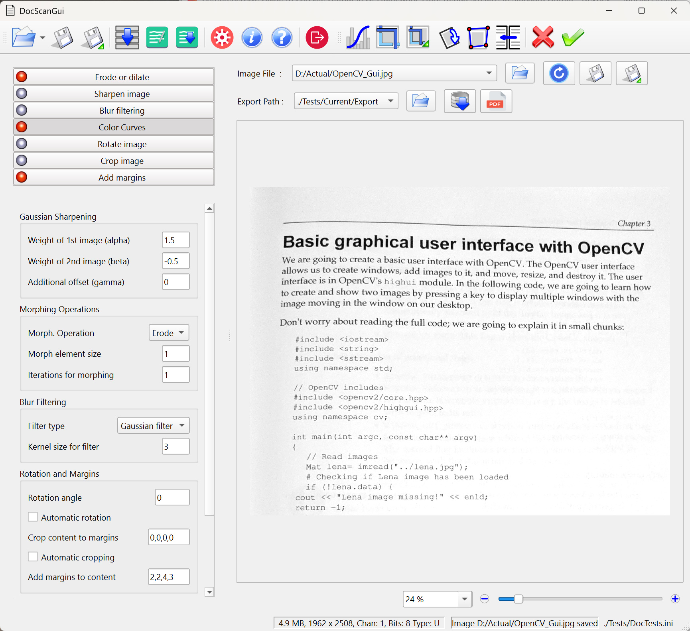

## What is DocScanGui?

DocScanGui is a simple, interactive tool for post-processing of scanned pages.

It has basic functions for sharpening or blurring images,
increasing contrast, adding margins to an image, and more.

In addition, you can rotate, crop, or deskew images within a GUI.
This allows you to directly see the results of an action so
that you can accept it or just reload the image.

Several defined commands can be run in a specific order as a predefined
tool chain. This is helpful if you want to apply the same actions to more images.

There is also a kind of scripting for most of the actions, which can
be run directly within the program or as a ‘jobfile’ from the command line.

The scanning process itself is not in the focus of the program.
It only works on already scanned images.

The full documentation is in the  [DocScanGui](DocScanGui.pdf) pdf.

## License

This software is licensed under the terms of the GNU General Public License
version 3 (GPLv3) or later.
Full text of the license is available in the [License](LICENSE.txt) file
and [online](https://www.gnu.org/licenses/gpl-3.0.html).

## Installing

There is no installer.
On windows you can just run the executable.
On a Linux system you have to compile it by yourself.

## Building

The program is developed with Qt6 for Windows and GNU / Linux.
It uses OpenCV in version 5.0, but a 4.10 or even older should also work.

There are no specific project files for **MacOS** as I have no development
platform for this.

For **Windows** there is a project file for Visual Studio 2026
(Community Edition) **DocScanGui.vcxproj**.
For Windows and Linux there is a project file for Qt Creator 20.0
**DocScanGui.pro**.

For a **Linux** system there is a build script in the main directory: **buildCV.sh**.
If you do not have OpenCV 5.x on your PC installed, then you can build it.
It gets the latest OpenCV 5.x version from github and then builds it.
There are user input commands between all steps, so you can stop it e.g.
if some dependencies are not fulfilled or in cse of errors.

### Requirements

- **Qt version 6.12** - also some older or versions should work.
- **OpenCV 5.0** - You need include files and libraries, for vcxproj you have
to change the paths in **OpenCV.props** or the paths in **DocScanGui.pro**.

## Git Repository

If you want to get the very latest version of DocScanGui direct from the
source code repository, then you will need to use git.
The git repo is hosted [on GitHub][1].

[1]: https://github.com/tec-leo/DocScanGui

### Bug Reports

## Copyright

DocScanGui was written by Oskar Leirich, Copyright (C) 2026.
